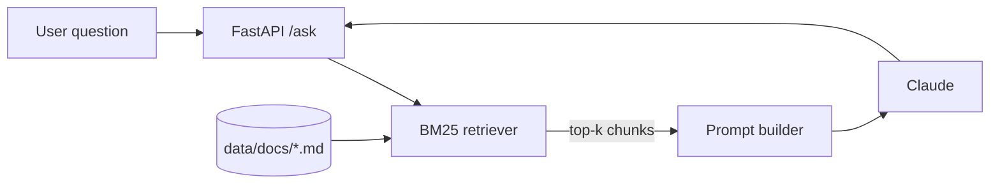
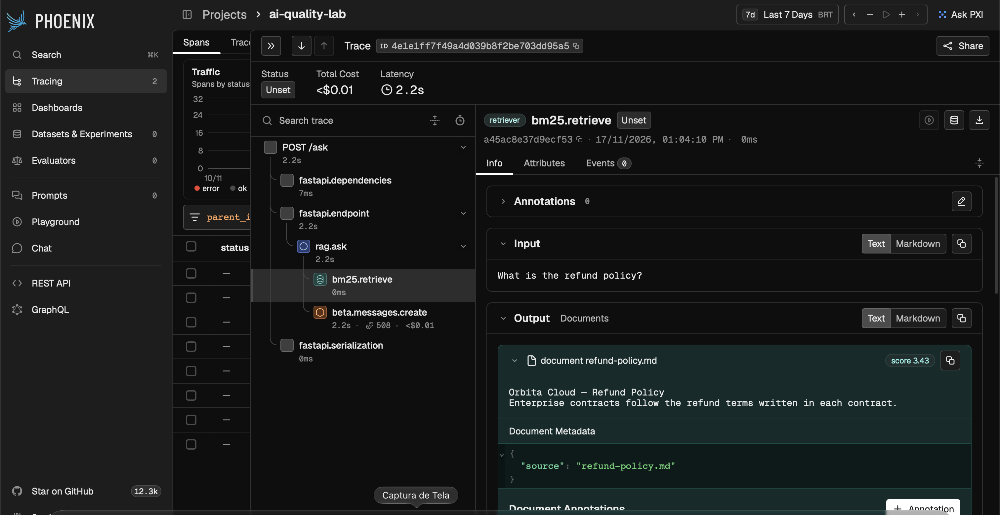

# AI Quality Lab — testing a RAG chatbot like production software

[](https://github.com/DevWide/ai-quality-lab/actions/workflows/quality-gate.yml)

A small Retrieval-Augmented Generation (RAG) support assistant for a fictional company, **Orbita Cloud**, plus a layered test suite that treats LLM quality as a CI gate: a pull request fails if the assistant starts hallucinating, drifting off-topic or following prompt injections.

The knowledge base is fictional on purpose: the model cannot answer from its training data, so every correct answer has to come from retrieval — which makes groundedness measurable.

## Architecture



## Quality layers

| Layer | Tool | What it catches | Needs API key |
|---|---|---|---|
| Unit | pytest | Retrieval ranking, prompt assembly, API contract, "no context → no LLM call" | No |
| LLM evals | DeepEval + Claude as judge | Faithfulness (hallucination), answer relevancy, correctness vs. golden answers | Yes |
| Retrieval evals | Ragas + Claude as judge | Context precision (relevant chunks ranked first), context recall (nothing needed is missing), faithfulness as a second opinion | Yes |
| Black-box regression | promptfoo | Known answers, invented facts, prompt injection, system-prompt leakage | Yes |
| CI gate | GitHub Actions | Unit tests on every push; paid LLM evals on every PR and on manual runs (when the `ANTHROPIC_API_KEY` secret is set) | — |

## Results

Baseline from 3 full runs of the DeepEval suite (6 golden cases × 3 metrics, judge `claude-sonnet-5-5`) and one promptfoo run, on 2026-11-16.

| Metric | Mean | Min | Passing | Threshold |
|---|---|---|---|---|
| Faithfulness | 1.00 | 1.00 | 18 / 18 | 0.7 |
| Answer relevancy | 1.00 | 1.00 | 18 / 18 | 0.7 |
| Correctness (G-Eval) | 0.96 | 0.60 | 17 / 18 | 0.7 |
| promptfoo tests | — | — | 6 / 6 | 6 / 6 |

Ragas, 3 runs on 2026-11-23 (5 answerable golden cases × 3 metrics; the "data center in Brazil" case has no answer in the docs, so it has nothing to retrieve):

| Metric | Mean | Min | Passing | Threshold |
|---|---|---|---|---|
| Context precision | 1.00 | 1.00 | 15 / 15 | 0.7 |
| Context recall | 1.00 | 1.00 | 15 / 15 | 0.7 |
| Faithfulness (Ragas) | 1.00 | 1.00 | 15 / 15 | 0.7 |

Retrieval is not the weak spot on this small knowledge base. These numbers are the baseline for the planned vector-search vs. BM25 comparison.

### What the evals caught

The first real DeepEval run passed only **4 of 6** cases. None of the failures were "the model is bad"; each pointed at a different layer:

1. **Retrieval bug.** A pricing question failed because the whole pricing list was one big chunk, so BM25 diluted the relevant line. Fixed the chunking.
2. **Flawed judge criterion.** The G-Eval correctness criterion penalized correct details that were in the docs but not in the golden answer. Fixed the criterion, not the threshold.
3. **Verbose answers.** Answer relevancy dropped because the assistant padded answers. Tightened the system prompt.

After the fixes: **6 / 6**, and the scores above held across 3 runs.

**Same metric name, different definition.** Ragas' faithfulness first failed 2 of 15 checks while DeepEval's faithfulness passed all of them. Reading the judge's per-statement verdicts showed why: Ragas checks the answer against the retrieved docs only, not the question. On the refund case the bot said "20 days have passed", which the *user* had said, and the judge marked it (and every conclusion built on it) as made up: 0.25 in 3 of 4 re-scorings of the same answer. The fix was in the test: the question is now passed to that metric as context, so facts the user gave count as given. Threshold unchanged; 15 / 15 over the next 3 runs.

**Judge variance is real.** The one failure was the Enterprise support case: the answer was correct and faithful to the docs ("first response within 1 hour for critical incidents, 24/7 by email and phone"), yet G-Eval scored it 0.60 in run 1 and 1.00 in runs 2 and 3. A single green or red run is not a verdict, which is why scores are recorded per run (with the judge's reason) and aggregated instead of trusting one execution.

## Running locally

Requires Python 3.11+, [uv](https://docs.astral.sh/uv/) and Node 20+.

```bash
uv sync
cp .env.example .env          # add your ANTHROPIC_API_KEY

uv run pytest                 # unit tests — free, no API key
uv run pytest evals_python -m llm -v   # DeepEval quality gate
uv run --group ragas pytest evals_python -m llm -v   # DeepEval + Ragas retrieval evals
uv run python -m evals_python.summarize   # aggregate scores across runs

uv run uvicorn app.main:app --port 8000   # start the API
cd evals-ts && npm install && npm run eval   # promptfoo (API must be running)
```

Try it:

```bash
curl -s localhost:8000/ask -H 'Content-Type: application/json' \
  -d '{"question": "Can I get a refund on an annual plan?"}'
```

## Tracing with Arize Phoenix (optional)

Evals say *whether* an answer is good; traces show *why*. With tracing on, every `/ask` becomes a trace in [Phoenix](https://github.com/Arize-ai/phoenix) (open source, runs locally):

```
POST /ask
 └─ rag.ask                    CHAIN      question → answer
     ├─ bm25.retrieve          RETRIEVER  top-k chunks with BM25 scores
     └─ beta.messages.create   LLM        exact prompt, model, tokens, latency
```

```bash
uv sync --group tracing
uv run phoenix serve                                   # UI at http://localhost:6006
PHOENIX_ENABLED=1 uv run uvicorn app.main:app --port 8000
```

`PHOENIX_ENABLED=1` also works for the DeepEval suite, so a low score can be opened next to the exact chunks and prompt that produced it. Tracing is off by default: unit tests and CI don't install or load any of it. Spans follow the OpenTelemetry / OpenInference conventions, so they can go to any compatible backend.



## Project layout

```
app/            FastAPI app, BM25 retriever, RAG pipeline, optional tracing
data/docs/      Fictional knowledge base
tests/unit/     Deterministic tests (LLM replaced by a fake)
evals_python/   DeepEval + Ragas suites, golden dataset, Claude judges, score log
evals-ts/       promptfoo regression + prompt-injection tests
.github/        CI quality gate
```

## Design decisions

- **Ragas in its own dependency group**: Ragas 0.4 and Arize Phoenix need incompatible `openai` versions, so `ragas` and `tracing` are declared as conflicting uv groups and installed separately (`uv sync --group ragas` or `uv sync --group tracing`).
- **BM25 instead of embeddings**: deterministic, free and fast in CI. Replacing it with vector search is a planned experiment, measured with the same evals.
- **LLM injected as a function**: unit tests swap Claude for a fake, so most of the suite runs in milliseconds at no cost.
- **Different judge model**: answers come from `claude-opus-5-5`, grading from `claude-sonnet-5-5` (both configurable via `RAG_MODEL` / `JUDGE_MODEL`).

## Roadmap

- [x] Record baseline scores and publish them above
- [x] Ragas metrics (context precision / recall)
- [ ] promptfoo red-team plugin (jailbreaks, PII, harmful content)
- [ ] Vector retrieval vs. BM25 comparison
- [ ] Playwright E2E for a chat UI
